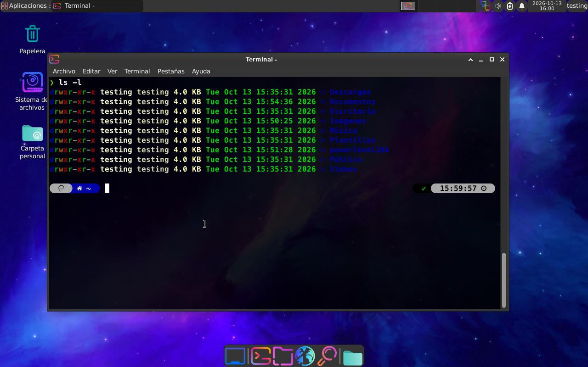

# Post Install XFCE · Linux

Script de post-instalación para configurar un entorno **XFCE** recién instalado. Automatiza la instalación de fuentes, `powerlevel10k`, fondos de pantalla, iconos y el tema oscuro, con soporte para **múltiples distribuciones de Linux**.

---

## Vista previa



---

## Características

- **Multi-distribución**: detecta tu distribución y gestor de paquetes automáticamente.
- **Fuentes**: instala `MesloLGS NF` (para powerlevel10k) y `Hack Nerd Font`.
- **powerlevel10k**: clona el tema y lo añade a `~/.zshrc`.
- **XFCE**: aplica bordes redondeados al panel mediante `gtk.css`.
- **Fondos de pantalla**: descarga una colección y establece uno por defecto.
- **Candy Icons**: descarga e instala el set de iconos y lo establece como tema.
- **Tema Adwaita-dark**: se configura como tema GTK en XFCE.
- **zsh** como shell por defecto.
- **Idempotente**: puede ejecutarse varias veces sin duplicar configuraciones.
- **Log**: toda la salida se guarda en `POST_INSTALL.log`.

---

## Distribuciones compatibles

El script soporta cualquier distribución con **XFCE** y uno de los siguientes gestores de paquetes:

| Gestor | Distribuciones típicas |
| --- | --- |
| `apt-get` | Debian, Ubuntu, Xubuntu, Linux Mint, Kali, MX Linux, Pop!_OS |
| `dnf` / `yum` | Fedora, RHEL, CentOS, Rocky, AlmaLinux |
| `pacman` | Arch Linux, Manjaro, EndeavourOS, Garuda, CachyOS |
| `zypper` | openSUSE Leap / Tumbleweed |
| `apk` | Alpine Linux |
| `xbps-install` | Void Linux |
| `emerge` | Gentoo |

> Requiere una sesión de escritorio **XFCE** activa para aplicar los cambios de tema, fondo e iconos. El resto de tareas (fuentes, zsh, p10k) funcionan en cualquier entorno.

---

## Requisitos

- Bash 4+.
- `sudo` (para instalar paquetes y cambiar el shell).
- Conexión a internet (descarga fuentes, temas, iconos y fondos).
- Un usuario **no root** para ejecutar el script.

Dependencias (`git`, `wget`, `unzip`, `zsh`, `curl`, `fontconfig`) se instalan automáticamente si faltan.

---

## Uso

```bash
# Dar permisos de ejecución
chmod +x post_install.sh

# Ejecutar (NO usar sudo)
./post_install.sh
```

Al finalizar, **reinicia el sistema** y:

1. Cambia la fuente de tu terminal a una de las **MesloLGS NF**.
2. Selecciona los iconos **Candy Icons** si no se aplicaron solos.

---

## Qué hace paso a paso

1. Verifica que no se ejecute como root ni con `sudo`.
2. Detecta la distribución y el gestor de paquetes.
3. Instala las dependencias base.
4. Descarga e instala `MesloLGS NF` y `Hack Nerd Font` en `~/.local/share/fonts`.
5. Clona **powerlevel10k** y lo añade a `~/.zshrc`.
6. Añade los bordes redondeados al panel de XFCE.
7. Descarga fondos de pantalla en `~/Pictures` y establece uno por defecto.
8. Descarga e instala **Candy Icons**.
9. Aplica el tema **Adwaita-dark**.
10. Establece **zsh** como shell por defecto.

---

## Estructura del proyecto

```
.
├── post_install.sh   # Script principal
├── README.md         # Documentación
└── LICENSE           # Licencia
```

---

## Solución de problemas

| Problema | Solución |
| --- | --- |
| `No se detectó un gestor de paquetes compatible` | Instala manualmente las dependencias indicadas en **Requisitos**. |
| Los iconos/fuentes no aparecen | Cierra sesión y vuelve a entrar, o ejecuta `fc-cache -f`. |
| `lolcat` no disponible | No es crítico; el script muestra la salida sin colores. |
| `xfconf-query no disponible` | Instala `xfce4-utils` / `xfconf` o configura el tema manualmente. |

---

## Licencia

Distribuido bajo la licencia MIT. Consulta el archivo [LICENSE](LICENSE) para más detalles.
